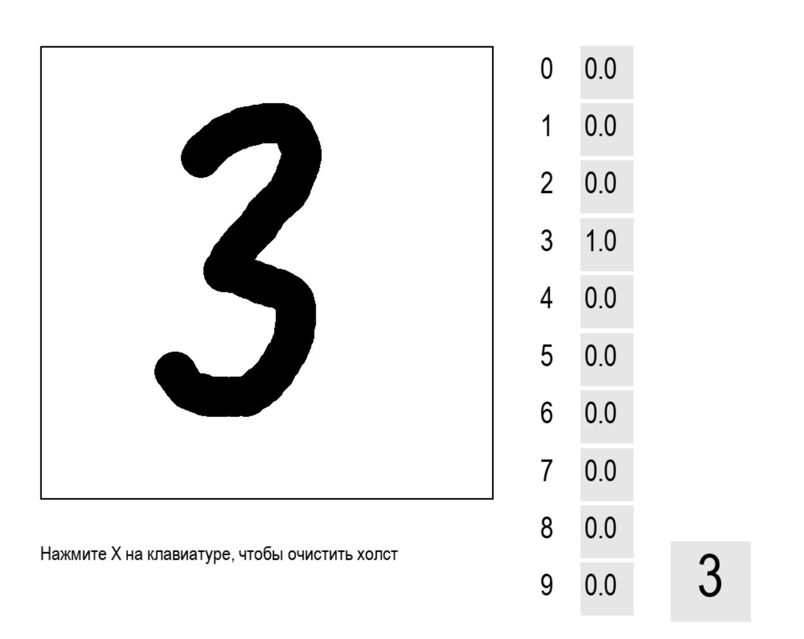

# CNN MNIST demonstration

Demonstration of working simple CNN trained on MNIST dataset.

### To try it

```
1. git clone https://github.com/AndreSamusenko/predict_digits
2. pip install -r "requirements.txt"
3. python main.py
```

### Demo


### Mobile browser demo

Open `web/index.html` in a browser. Draw with a finger or mouse to see the
three most likely digits update as you draw. Inference runs on the device.
The bundled weights come from the existing Keras model. To regenerate them
after changing the weights, install h5py and run `python web/export_weights.py`.
